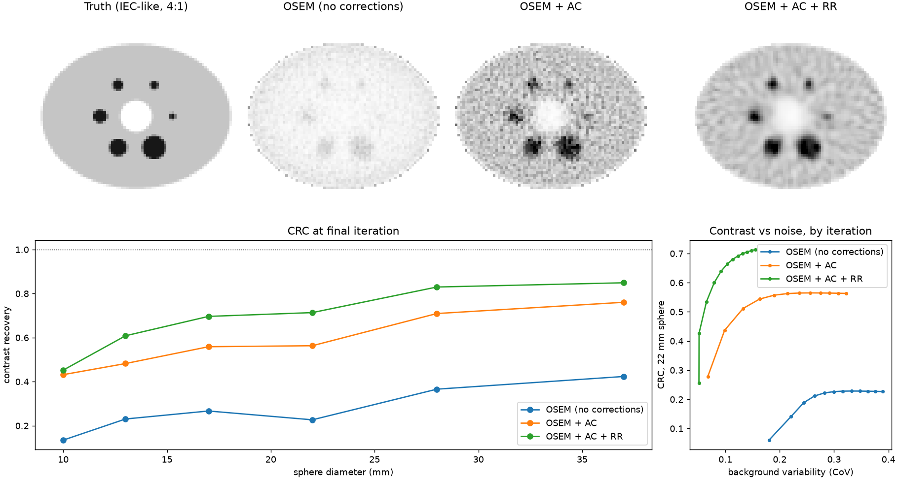
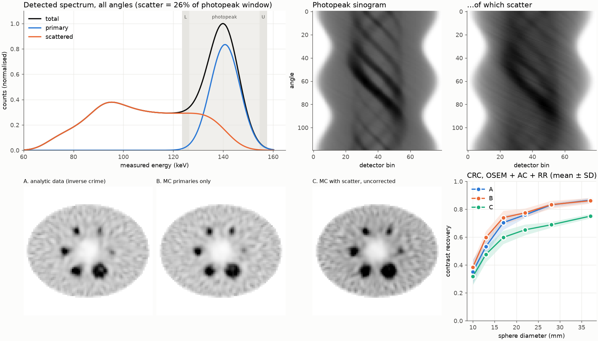
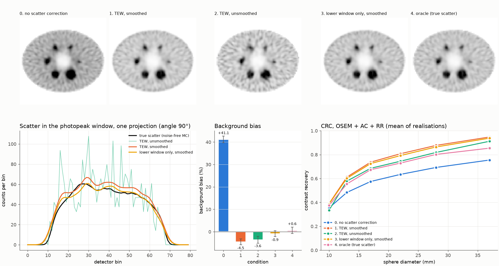
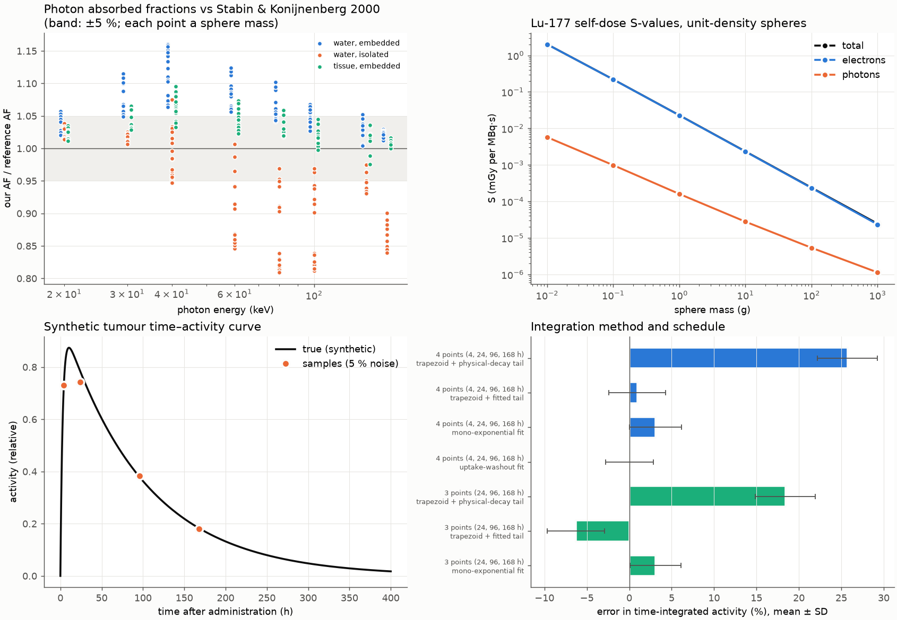

# nucmed-pipeline

A small nuclear medicine imaging pipeline written from scratch in Python. It goes from emitted photon to reconstructed image to absorbed dose. **Every stage is tested against an analytic or published reference.**

```
phantom ──► SPECT forward model ──► OSEM reconstruction ──► quantification ──► dosimetry
 (IEC-like)  analytic projector, or   MLEM / OSEM with        contrast recovery,   (Stage 4:
             Monte Carlo photon       attenuation and         background           Lu-177 MIRD
             transport with scatter   resolution recovery,    variability, bias    S-values, TAC
                                      TEW scatter correction                       integration)
```



*Top: a 2D slice through an IEC-like phantom (4:1 sphere-to-background), reconstructed with OSEM (12 iterations × 8 subsets, 10⁶ counts): with no corrections, with attenuation correction (AC), and with AC plus resolution recovery (RR). All images share one intensity scale, so the uncorrected image is faint: without AC, SPECT underestimates absolute activity. Bottom: contrast recovery per sphere, and the contrast–noise trade-off as iterations increase.*

## Result (from `scripts/run_iec_demo.py`, seed 20261105)

Contrast recovery coefficient (CRC) at the final iteration:

| Sphere (mm) | 10 | 13 | 17 | 22 | 28 | 37 | Background CoV |
|---|---|---|---|---|---|---|---|
| OSEM, no corrections | 0.14 | 0.23 | 0.27 | 0.23 | 0.37 | 0.42 | 0.39 |
| OSEM + AC | 0.43 | 0.48 | 0.56 | 0.56 | 0.71 | 0.76 | 0.32 |
| OSEM + AC + RR | 0.45 | 0.61 | 0.70 | 0.71 | 0.83 | 0.85 | 0.16 |

Full per-iteration values and run metadata are in [`results/iec_demo/metrics.json`](results/iec_demo/metrics.json).

**Caveats, stated up front.**
- This table is **one Poisson noise realisation**, so treat each value as ±0.05 or so. When the water μ was corrected from 0.154 to the XCOM value 0.1537 (Stage 2), the same seed produced a different noise draw and values moved by up to 0.05. Stage 2 below uses 10 realisations and reports mean ± SD.
- The AC+RR result is an *inverse crime*: the data were simulated with the same system model used to reconstruct them, so it is an upper bound.
- There is no scatter yet.
- Metrics are 2D NEMA-style approximations, not NU 2 compliant.
- Without corrections, the background CoV includes the cupping artefact (non-uniformity) as well as noise.

## Stage 2: Monte Carlo with scatter (from `scripts/run_mc_demo.py`, seed 20261105)



*A photon-transport Monte Carlo (Compton, Rayleigh and photoelectric absorption in water, with cross-sections from NIST XCOM; forced detection; 10 % energy resolution) generates projections of the IEC-like phantom on a 2 mm grid. The Stage 1 reconstructor (4 mm, OSEM + AC + RR, 12 it × 8 subsets) then reconstructs three data sets at the same calibration and 10⁶ expected primary counts, with 10 noise realisations each. The spectrum below ~100 keV is truncated by the 90 keV tracking cut-off.*

In the 20 % photopeak window (126–154 keV), **26 % of detected counts are scattered photons**. Mean ± SD over 10 realisations:

| Data | CRC 10 mm | 13 | 17 | 22 | 28 | 37 | Background bias | Lung / background (truth 0) |
|---|---|---|---|---|---|---|---|---|
| A. analytic projector (inverse crime) | 0.35 ± 0.09 | 0.53 ± 0.05 | 0.70 ± 0.05 | 0.76 ± 0.02 | 0.83 ± 0.02 | 0.87 ± 0.02 | +0.2 % | 0.25 |
| B. MC, primaries only | 0.39 ± 0.05 | 0.60 ± 0.05 | 0.74 ± 0.05 | 0.77 ± 0.03 | 0.83 ± 0.03 | 0.86 ± 0.02 | +0.2 % | 0.25 |
| C. MC with scatter, uncorrected | 0.32 ± 0.06 | 0.48 ± 0.06 | 0.60 ± 0.05 | 0.65 ± 0.04 | 0.69 ± 0.02 | 0.75 ± 0.02 | **+41 %** | 0.32 |

What this shows:
- **Removing the inverse crime costs almost nothing here (A vs B).** An independent forward model, with a finer grid, continuous emission points and its own ray tracing, gives the same CRC within noise. This is because the reconstructor's attenuation and collimator models are correct; the only mismatch is discretisation.
- **Scatter is what hurts (B vs C).** Uncorrected scatter lowers CRC by about 0.1 for the larger spheres, adds 41 % to the background activity estimate, and fills the cold lung insert. Matching the pre-registered expectation, CRC(C) < CRC(A) for every sphere and the bias is positive. Stage 3 corrects it.

Caveats: 2D slice of an axially infinite phantom (this overstates scatter from out-of-slice activity relative to a finite phantom); Rayleigh angles use Thomson without a form factor; the collimator response is the same Gaussian model as the reconstructor (no septal penetration); metrics are 2D NEMA-style.

## Stage 3: TEW scatter correction (from `scripts/run_tew_demo.py`, seed 20261106)



*Triple-energy-window (TEW) scatter estimates are computed from two 3 keV windows beside the 126–154 keV photopeak and used as the additive term in OSEM + AC + RR. The data are the Stage 2 Monte Carlo projections (10⁶ expected primary counts, 10 realisations, independent Poisson noise per window).*

| Condition | Background bias | Scatter estimate / true | CRC 10 mm | 22 mm | 37 mm | Background CoV |
|---|---|---|---|---|---|---|
| 0. no scatter correction | +41.1 ± 1.5 % | – | 0.35 | 0.63 | 0.76 | 0.14 |
| **1. TEW, smoothed** (pre-specified primary) | **−4.5 ± 1.3 %** | 1.14 | 0.39 | 0.81 | 0.95 | 0.17 |
| 2. TEW, unsmoothed | −3.6 ± 1.5 % | 1.14 | 0.33 | 0.74 | 0.91 | 0.25 |
| 3. lower window only, smoothed | −0.9 ± 1.3 % | 1.04 | 0.39 | 0.79 | 0.94 | 0.16 |
| 4. oracle (true scatter) | +0.6 ± 1.4 % | 1.00 | 0.37 | 0.73 | 0.85 | 0.16 |

What this shows:
- **TEW removes most of the scatter bias** (+41 % → −4.5 %), meeting the pre-registered target. It over-corrects, by the amount predicted before the run from the window totals: primary photons spill into the side windows at 10 % energy resolution, so TEW overestimates the scatter by 14 %. Dropping the upper window, which is 94 % primaries here, brings the bias to −0.9 %.
- **Without smoothing, TEW is noisy.** Background CoV rises from 0.17 to 0.25, because the side windows hold only about 6 % of the photopeak counts.
- **Be suspicious of a CRC above the oracle's.** TEW gives a 37 mm CRC of 0.95, *higher* than perfect scatter knowledge (0.85) or scatter-free data (0.86). That is not better imaging. *Exploratory noise-free diagnostics* (`scripts/diag_tew.py` → `results/tew/diagnostics.json`) attribute it to the estimate being too large and too smooth:
  - Rescaling TEW to the true total removes the bias but still gives a CRC of 0.88.
  - Smoothing the *true* scatter the same way also lifts CRC from 0.85 to 0.88.
  - TEW over-estimates more in low-count, peripheral projection bins (+19 %) than in sphere-crossing ones (+10 %), so it subtracts relatively more from the background.
  - The rest of the gap (noise-free 0.905 vs noisy 0.95) appears only with noise. I haven't explained that part yet.
  - Contrast recovery read alone would reward over-correction. Bias against known truth catches it.

## Stage 4: Lu-177 dosimetry (from `scripts/run_dosimetry_demo.py`, seed 20261107)



*Top left: photon absorbed fractions (AF) from our 3D photon Monte Carlo against the EGS4/MCNP reference values of Stabin & Konijnenberg (J Nucl Med 2000), for every tabulated sphere at 20–208 keV. Top right: Lu-177 self-dose S-values for unit-density spheres; electrons dominate, so the total curve sits on the electron curve. Bottom: a synthetic tumour time–activity curve and the error of different ways to integrate it (2000 noise draws).*

All reference data are fetched by `scripts/fetch_reference_data.py`, which records where each number came from:
- **Decay data:** ENSDF via the IAEA LiveChart API.
- **Electron ranges:** NIST ESTAR.
- **Photon data:** NIST XCOM, and NIST μ_en.
- **Sphere absorbed fractions:** parsed from the free full text of Stabin & Konijnenberg 2000, with an internal consistency check on every row.

**Validation against references:**

| Check | Result |
|---|---|
| T4.1 Lu-177 decay data | T½ = 6.6443 d; spectrum mean 132.6 keV vs branch mean 133.6 keV (0.8 %); spectrum integrates to 1.0001 per decay. **Met.** |
| T4.2 photon AF within max(5 %, EGS4–MCNP spread) of the reference | **Partially met: 59/112 rows.** 37/37 rows pass at 100–160 keV, the range of Lu-177's gammas (113, 208 keV). It fails at 30–60 keV, where our water model absorbs 5–16 % more than the reference. |
| T4.3 small-sphere limit, AF → μ_en·3R/4 | **Met** (100 and 208 keV, within 5 %). |
| T4.4 straight-line CSDA model is a lower bound on the electron AF | **Met** on 95/95 rows. |
| T4.5 photon point kernel: energy conservation, and sphere AF from the kernel = direct simulation | **Met** (≥ 99 %; within 3 %). |
| T4.6 TAC fits and integrals exact on noise-free data | **Met.** |

**What went wrong first, and why T4.2 is only partly met.**
- **Geometry.** My first photon model was an isolated sphere in vacuum, which came out up to 19 % low. The reference spheres sit *inside an infinite unit-density medium*, so photons can scatter back in. Matching that geometry fixed the shape of the disagreement but left a low-energy excess.
- **Composition (exploratory).** The reference used MIRD tissue, not water. Water has more oxygen per gram, and the photoelectric effect rises steeply with atomic number. Re-running with XCOM data for ICRU four-component soft tissue brings 104/112 rows within tolerance (all ≥ 60 keV rows), median ratio 1.03.
- **Not claimed.** I haven't matched the exact MIRD composition, and I don't claim the remaining 30–40 keV residual is explained.
- **Effect on Lu-177.** Photons are ≤ 5 % of the S-value for spheres ≤ 1 kg, and the photon error at Lu-177 energies is ≤ 5 %, so the effect on Lu-177 S-values is below 0.3 %. All rows, for all three model variants, are in [`results/dosimetry/photon_af_validation.csv`](results/dosimetry/photon_af_validation.csv).

**Lu-177 S-values** (unit-density spheres, electrons from the reference tables, photons from our MC):

| Mass | 0.01 g | 0.1 g | 1 g | 10 g | 100 g | 1 kg |
|---|---|---|---|---|---|---|
| S (mGy per MBq·s) | 2.01 | 0.220 | 0.0229 | 2.34·10⁻³ | 2.38·10⁻⁴ | 2.45·10⁻⁵ |
| electron AF | 0.85 | 0.93 | 0.96 | 0.98 | 0.99 | 0.99 |
| photon share of S | 0.3 % | 0.4 % | 0.7 % | 1.2 % | 2.3 % | 4.6 % |

The reference tables start at 0.1 MeV. Bounding the electron AF below that energy between φ(0.1 MeV) and 1 moves S by < 0.5 %. There is **no external Lu-177 S-value check**: the voxel S-value database planned as the reference (Lanconelli et al. 2012) needs a registered login, and I didn't register. That comparison is deferred, not done.

**Time–activity integration** (synthetic tumour: uptake half-time 2 h, biological washout half-life 120 h, 5 % noise; descriptive):
- Trapezoid integration with a physical-decay-only tail overestimates the time-integrated activity by 26 % (4 time points) and 18 % (3 points), because it ignores biological washout after the last sample.
- With a tail fitted to the last two points the error is +0.9 % (4 points) and −6.3 % (3 points; the first-day uptake is missed).
- A fitted uptake–washout model is unbiased with 4 points (SD 2.8 %).

Caveats: spheres only, so no voxel-level dose convolution yet; unit density; electron AFs are reference data, not something this code computes; the kinetics are synthetic.

## What is validated (`uv run pytest`)

| Module | Check | Reference |
|---|---|---|
| `projector` | ⟨Ax, y⟩ = ⟨x, Aᵀy⟩ | matched projector/backprojector pair |
| `projector` | counts conserved per angle without attenuation | geometry |
| `projector` | point-source centroid s = x cos θ + y sin θ; variance = σ(d)² + Δs²/12 | analytic |
| `projector` | attenuation factor = exp(−μ · chord length) in a uniform disk | analytic chord length |
| `recon` | MLEM preserves total counts every iteration | EM property |
| `recon` | Poisson log-likelihood never decreases | EM monotonicity |
| `recon` | OSEM with 1 subset ≡ MLEM | definition |
| `recon` | AC restores a flat uniform disk; no AC → centre/rim < 0.7 | analytic truth |
| `phantom` | supersampled disk area = πr² | analytic |
| `phantom` | background ROIs inside the body and clear of spheres and lung | geometry |
| `decay` | matrix-exponential Bateman solution = closed-form two-member solution | Bateman equations |
| `decay` | Tc-99m activity peaks at t_max = ln(λd/λp)/(λd−λp) ≈ 23 h | analytic |
| `decay` | transient equilibrium A_d/A_p → b·λd/(λd−λp) | analytic |
| `xsections` | μ(water, 140.5 keV) = 0.1537 cm⁻¹; partials sum to the total | NIST XCOM |
| `xsections` | Klein–Nishina total × electron density within 3 % of XCOM incoherent, and above it | XCOM (binding) |
| `xsections` | KN angular pdf integrates to 1; → Thomson as E → 0 | analytic |
| `mc` | sampled Compton angles fit Klein–Nishina (χ², 10⁶ samples, p > 0.01); same for Thomson | analytic |
| `mc` | direction rotation gives the requested scattering angle; Compton energy formula and 90.7 keV edge | kinematics |
| `mc` | narrow-beam μ from simulated transmission through 10 cm of water within 2 % of XCOM | NIST XCOM |
| `mc` | Woodcock tracking through a water + lung slab gives exp(−ΣμᵢLᵢ) within 2 % | analytic |
| `scatter` | TEW trapezoid exact for a linear spectrum; smoothing preserves counts and wraps in angle | analytic |
| `recon` | OSEM with the exact additive term recovers a contaminated uniform disk (ignoring it: > 15 % high) | analytic truth |
| `radionuclide` | Lu-177 T½; beta spectrum mean and integral vs ENSDF branches; principal gamma yields | ENSDF (IAEA) |
| `photon3d` | photon AF in spheres vs EGS4/MCNP (regression guard; full pre-registered check in the demo) | Stabin & Konijnenberg 2000 |
| `photon3d` | small-sphere AF → μ_en·3R/4 | NIST μ_en |
| `photon3d` | point kernel conserves energy; reproduces the direct sphere AF | consistency |
| `dosimetry` | distance-to-surface distribution 3L/4R − L³/16R³ (sampled) | analytic chord result |
| `dosimetry` | straight-line CSDA electron AF ≤ reference AF (lower bound) | NIST ESTAR, reference tables |
| `dosimetry` | TAC fits and integrals exact on noise-free data; trapezoid converges | analytic |
| `mc` | primary-only MC sinogram = analytic projector: total within 2 %, NRMSE < 5 % (observed 0.06 %, 1.2 %) | independent model |

## Run it

```bash
uv sync
uv run pytest                          # 106 tests, ~30 s
uv run python scripts/run_iec_demo.py  # Stage 1, ~2 s on an Apple M5
uv run python scripts/run_mc_demo.py   # Stage 2, 10⁶ photons, ~70 s
uv run python scripts/run_tew_demo.py  # Stage 3, uses Stage 2 output, ~6 s
uv run python scripts/run_dosimetry_demo.py  # Stage 4, ~90 s
uv run python scripts/fetch_reference_data.py  # re-download all reference data (network)
```

## Layout

```
src/nucmed/
  geometry.py    image grid, acquisition, collimator response model
  phantom.py     IEC-like, uniform disk, point source; ROI masks
  projector.py   sparse system matrix: attenuation + depth-dependent blur
  recon.py       MLEM / OSEM, Poisson log-likelihood
  metrics.py     CRC, background variability, NRMSE
  noise.py       count scaling, Poisson noise
  decay.py       Bateman chains, Mo-99/Tc-99m generator
  xsections.py   NIST XCOM water data, Klein–Nishina, Thomson
  mc.py          Monte Carlo transport: Woodcock tracking, forced detection, energy windows
  scatter.py     TEW scatter estimate, sinogram smoothing
  radionuclide.py  Lu-177 decay data (ENSDF)
  photon3d.py    3D photon MC: absorbed fractions in spheres, point kernels
  dosimetry.py   TAC fitting/integration, electron AFs, MIRD sphere S-values
  data/          reference tables (XCOM, ENSDF, ESTAR, NIST μ_en, Stabin & Konijnenberg 2000) with provenance
tests/           analytic and property tests
scripts/         reproducible runs that write to results/
```

## Roadmap

See [`DESIGN.md`](DESIGN.md). Done: Monte Carlo photon transport (Stage 2), TEW scatter correction (Stage 3), Lu-177 sphere dosimetry (Stage 4). Possible next steps: voxel-level dose and the Lanconelli voxel S comparison (needs a registered download), an end-to-end Lu-177 imaging → dose chain, optional GPU (JAX/MLX).

## Data and scope

Synthetic phantoms only; no patient data. This is an educational and research implementation, not a medical device. Physical constants marked `[verify]` in the source are working values that have not yet been checked against their primary source.

MIT licence.
